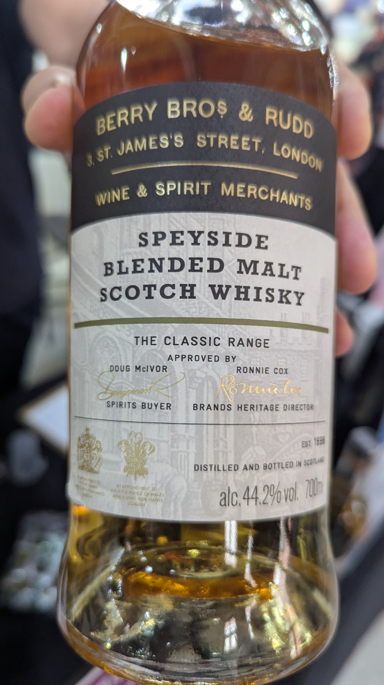

# The Classic Range Speyside BBR 44.2%

### 【香氣】剛開瓶時酒精氣息比較明顯，稍微醒酒後，稻草與軟柿子的氣味慢慢浮現，尾端帶著一點淡淡的煙燻感。
### 【味道】酒體偏烈，年輕感很直接，入口有黃金糖的甜味，接著轉出木頭香氣；整體風味比較簡單。
### 【結語】這款由 BBR 裝瓶、隸屬 The Classic Range 的 Speyside Blended Malt，以 44.2% 酒精濃度呈現。剛開瓶時有些中式白酒般的氣味，放一會兒後會順一些；不過整體表現仍偏單薄，適合讓它多透透氣再喝。
### 【日期】2026.11.18
### 【評分】84

#bbr
#whisky
#whiskylover
#whiskey
#spicy9night

