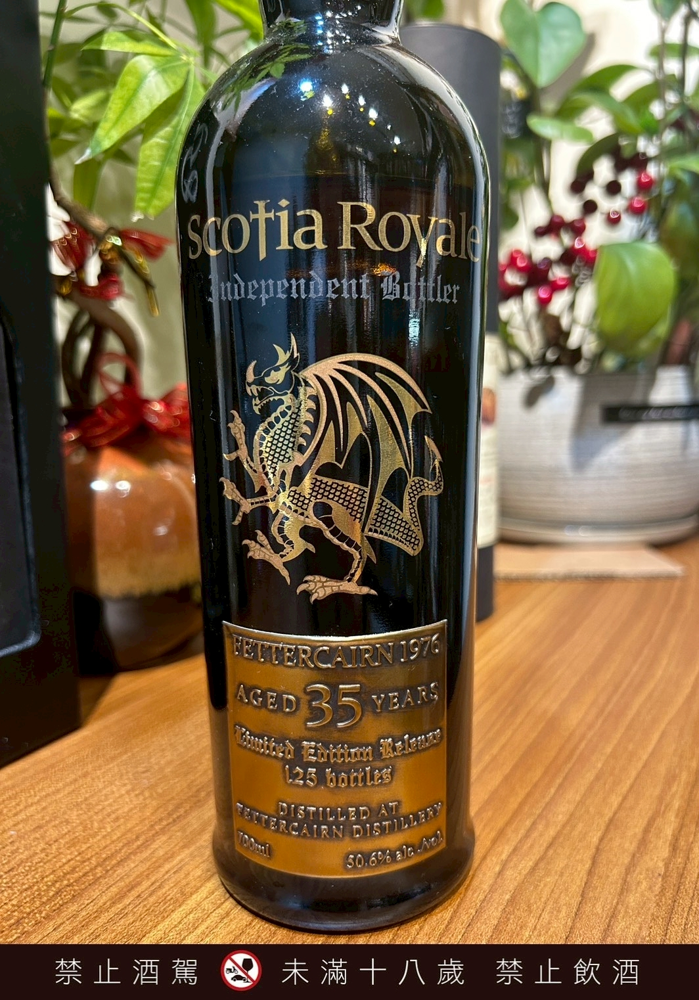
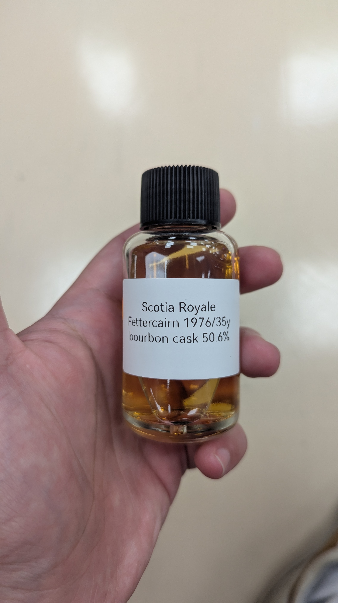

# Fettercairn  Scotia Royale 1976 35yo Bourbon Casks 50.6%

### 【香氣】強烈的硫與泡泡膠氣息先行，隨後慢慢打開出成熟熱帶果實的甜香，桃子與哈密瓜的果香在杯中漸漸浮現。
### 【味道】味道非常濃郁，油脂感豐富但仍帶有明顯的新酒感；入口像是滾燙的鼎泰豐湯包在嘴裡，辣口但又香，桃子與哈密瓜的果甜與略帶辛感的橡木互相交織，50.6% 的酒精度讓香氣與口感更為直接有力。
### 【結語】剛開瓶時有較明顯的琉味與臭味，但放一會兒後香氣大幅爆發、變化豐富，成熟水果味道非常濃烈，是一支既有力量又有趣味性的 1976 年 Fettercairn單一麥芽。
### 【日期】2026.9.18
### 【評分】92
### 【價格】30800

#whisky #whiskylover #whiskey #spicy9night #fettercairn #scotiaroyale

