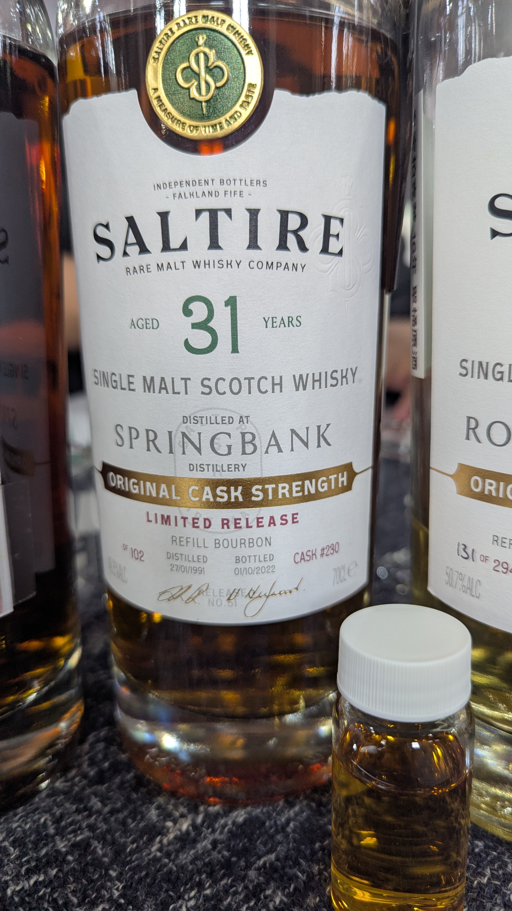
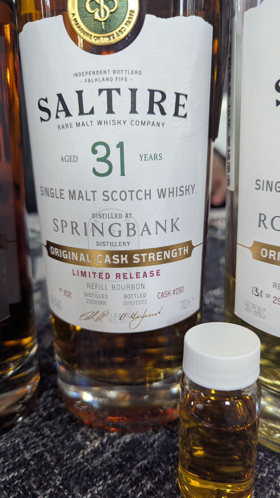

🥃
# Limited Release No. 51 Springbank Saltire 1991 31yo Refill Bourbon 48.3%

### 【香氣】水蜜桃與梅子的果香清楚，甜美之中帶著一點柔和的酸香，聞起來清新討喜。
### 【味道】入口是鮮甜的水蜜桃，接著浮出些許烤麵包香氣；丹寧感舒服，不會搶走果味的風采。這款 31 年的單一麥芽威士忌由 Saltire 裝瓶，使用 Refill Bourbon 桶熟成，以 48.3% 裝瓶，酒體與風味都顯得柔順而有層次。
### 【結語】果味十足，水蜜桃特別明顯，酸甜感拿捏得剛剛好，像是在喝一杯清爽的水果茶。喝起來輕鬆又舒服。
### 【日期】2026.11.16
### 【評分】92
### 【價格】1000

Saltire Rare Malt Whisky Company 
是一家近年在蘇格蘭與亞洲威士忌圈迅速竄紅的新銳獨立裝瓶廠（IB）。

1. 創辦背景與地理位置創立時間與創辦人：
   由兩位交情超過 30 年的蘇格蘭威士忌資深藏家 Nigel Heywood 與 Keith Rennie 於 2024 年正式創立（酒標底部簽名即為這兩位創辦人）。
   
   在正式成立品牌前，他們已花費數十年時間私下收藏與追蹤蘇格蘭各酒廠的優質單桶。   總部與歷史

   淵源：
   總部設於蘇格蘭法夫王國（Kingdom of Fife）的歷史小鎮 Falkland，
   店址就位於 Falkland Palace（福克蘭宮） 對面的市集廣場。
   這裡在蘇格蘭威士忌歷史上極具象徵意義
   1494 年蘇格蘭國王詹姆斯四世正是在此下達了人類歷史上第一份威士忌釀造的文字紀錄（著名的 Friar John Cor 買麥芽釀酒紀錄）。

   品牌名稱意涵：
   「Saltire」即為蘇格蘭國旗上的聖安德魯十字（白底藍十字），
   展現其純正的蘇格蘭傳統與榮耀；
   品牌標語則是 "A Measure of Time and Taste"（時間與品味的度量）。   

2. 選桶哲學與專家背書重量級選桶顧問：
    Saltire 邀請了國際知名的荷蘭威士忌作家夫婦 Hans & Becky Offringa（人稱「Whisky Couple」）擔任品牌大使與選桶顧問，
    共同為單桶把關。
    
    產品線與裝瓶特色：
    堅持非冷凝過濾（Non-Chill Filtered）與自然酒色（Natural Colour）。
    
    旗下酒款主要分為兩大方向：
    一是裝瓶酒精度設定在 48.8% 的核心單桶系列
    （涵蓋 10～20 年左右的雪莉與波本桶，如 Benrinnes、Ardmore、Caol Ila、Dailuaine 等）
    以及與專家合作挑選的 Cigar Malt（雪茄威士忌）系列；
    二是高年份、極少量的原桶強度（Original Cask Strength）限量系列。   
    
   

#springbank
#saltire
#whisky
#whiskylover
#whiskey
#spicy9night

